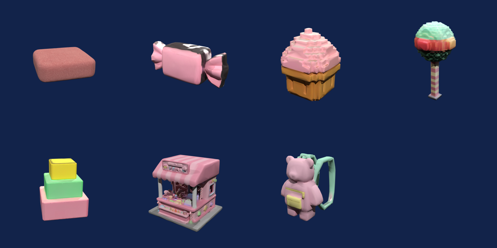
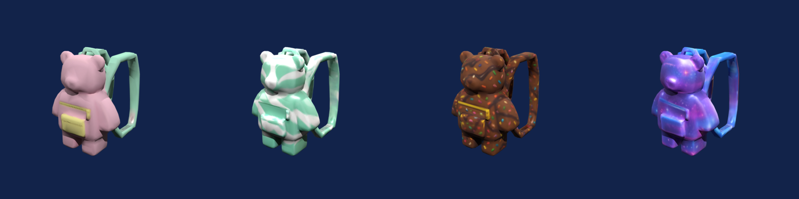

# Roblox Studio Team

[Agent Skills](https://agentskills.io) that give your coding agent a small Roblox game studio. Describe your game in one line and get a playable Roblox place with your own 3D models, shop skins to sell and a custom sky, made with the [Sloyd API](https://www.sloyd.ai/api).



```sh
npx skills add Sloydai/roblox-studio-team --all
```

Works with Claude Code, Codex, Cursor, opencode, Kiro and GitHub Copilot. You need your own Sloyd API key and Blender (free). [Step-by-step install](#install) takes about 10 minutes.

Made by [Sloyd](https://sloyd.ai). If it saves you a week of modelling, give it a star.

Making a Roblox game means hunting the Toolbox for props that don't match, or modelling them yourself, then fighting the importer: models over the 20,000-triangle limit, the wrong size, sunk into the floor. These skills do that part for you, and write the game code around the models.

## What it does

1. **Designs the game.** It turns your idea into a one-page design and an asset list, and shows you the cost before spending anything.
2. **Makes the 3D models.** Every prop in one matching style, made by Sloyd.
3. **Makes them Roblox-ready.** Under the 20,000-triangle limit, sized in studs, sitting on the floor, with textures sized for Roblox. Every file is checked before you get it.
4. **Makes skins you can sell.** New looks for the same item, with prices, wired into an in-game shop.
5. **Makes a custom sky.** Six images, the right way round for Roblox.
6. **Writes the game.** Luau code for the course, coins, checkpoints, saving and the shop, and a place file you can open in Studio.

| Skill | Role |
|---|---|
| `roblox-producer` | Runs the whole thing from one request. Start here. |
| `game-designer` | Design doc and asset list |
| `prop-modeler` | 3D models that pass Roblox's limits |
| `skin-variants` | Shop skins and prices |
| `world-backdrop` | Custom Roblox sky |
| `luau-scripter` | The game code (Rojo project) |
| `studio-importer` | Step-by-step help in Roblox Studio |
| `sloyd-api` | Shared setup: API key, credits, job polling, errors |

## Real example

We asked for "an obby in a candy world". [See the run.](examples/candy-climb/)

- **Result:** 7 props, 3 backpack skins and a sky in one run, for 245 credits (about $3.27). All 10 models passed Roblox's limits on the first try.
- **Shop skins:** one backpack, four looks (free, 15, 30 and 60 coins).



## Install

Takes about 10 minutes. Do the steps in order.

### Before you start

You need these six things. Check each one.

| You need | Check it with | If it's missing |
|---|---|---|
| A coding agent, for example [Claude Code](https://docs.claude.com/en/docs/claude-code) | `claude --version` in a terminal | Install it from the link |
| Node.js 18 or newer | `node --version` in a terminal | Download the LTS version from [nodejs.org](https://nodejs.org) |
| Python 3.9 or newer | Mac/Linux: `python3 --version`<br>Windows: `python --version` | Download from [python.org](https://www.python.org/downloads/). On Windows, tick **Add python.exe to PATH** in the installer |
| Blender (free) | Step 5 checks it for you | Download from [blender.org](https://www.blender.org/download/) and install it with the default settings |
| Roblox Studio | You can open it | Download from [create.roblox.com](https://create.roblox.com/) |
| A Sloyd account | | Sign up free at [sloyd.ai](https://www.sloyd.ai) |

You never have to open Blender yourself. The skills use it in the background to get the models ready for Roblox.

### Step 1. Open a terminal in your game project folder

Make a new folder for your game if you don't have one. Every command below runs in this folder, for example:

```sh
cd ~/projects/my-roblox-game
```

On Windows: `cd C:\Users\you\projects\my-roblox-game`

### Step 2. Install the skills

```sh
npx skills add Sloydai/roblox-studio-team --all
```

If it asks `Ok to proceed?`, type `y` and press Enter.

✅ You should see **Done!** at the end, and a new `.agents/skills` folder in your project.

### Step 3. Get your Sloyd API key

1. Go to [api-dashboard.sloyd.ai](https://api-dashboard.sloyd.ai) and sign in.
2. Open **API Keys** and click **Generate Key**.
3. Keep that page open. You'll copy the **Client ID** and the **Client Secret** in the next step. The secret is only shown once.
4. Open **Usage & Billing** and buy credits. The minimum is $12 for 900 credits, enough for about three small games.

### Step 4. Save your key

Mac/Linux:

```sh
python3 .agents/skills/sloyd-api/scripts/sloyd.py setup
```

Windows:

```powershell
python .agents\skills\sloyd-api\scripts\sloyd.py setup
```

It asks two questions:

1. **Client ID:** paste it and press Enter.
2. **Client Secret:** paste it and press Enter. Nothing appears on screen while you paste. That's normal.

✅ You should see **Done. Your key works** and your credit balance.

The key is saved in a `.env` file in your project, and `.env` is added to `.gitignore` so it never gets committed. Never paste the secret into the chat with your agent.

### Step 5. Check everything

Mac/Linux:

```sh
python3 .agents/skills/roblox-producer/scripts/check_setup.py
```

Windows:

```powershell
python .agents\skills\roblox-producer\scripts\check_setup.py
```

✅ You should see `[ok]` on every line and **All set.** at the end.

If a line says `[missing]`, the line under it says exactly what to do. Do it, then run this step again.

### Step 6. Start your agent in the same folder

```sh
claude
```

If your agent was already open, close it and start it again. Skills only load when the agent starts.

### Step 7. Ask for your game

Type this into your agent, changing the idea to yours:

> Use roblox-producer to make an obby in a candy world.

The agent shows you the design, the list of models and the cost, and **waits for your OK before it spends any credits.** Then it makes everything. That takes about 15 minutes.

### Step 8. Open it in Roblox Studio

When it's done, the agent walks you through Roblox Studio step by step. The short version:

1. Open `roblox-game/SloydGame.rbxlx` in Roblox Studio and press **Play**. The game already works, with simple blocks where the models go.
2. **File → Import**, open the `roblox-assets/import` folder, select all the files in it, and click **Import**.
3. **View → Command Bar**, paste the contents of `roblox-game/studio/SetupImportedAssets.luau`, and press Enter.
4. Press **Play** again. Your models are in the game.

Stuck on any step? Ask your agent: *"Use studio-importer to help me import my models."*

## If something goes wrong

| What you see | What to do |
|---|---|
| `npx: command not found` or `node: command not found` | Install Node.js (see [Before you start](#before-you-start)), then close and reopen the terminal |
| Windows: `npx.ps1 cannot be loaded because running scripts is disabled` | Use `npx.cmd skills add Sloydai/roblox-studio-team --all` instead |
| `python3: command not found` (Mac/Linux) | Install Python from [python.org](https://www.python.org/downloads/), then reopen the terminal |
| Windows: `python` opens the Microsoft Store | Install Python from [python.org](https://www.python.org/downloads/) and tick **Add python.exe to PATH** |
| `can't open file ... sloyd.py` or `check_setup.py` | You're in the wrong folder. `cd` into your game project (Step 1), the one with `.agents` inside |
| `Sloyd rejected this key` | Copy the ID and secret again from the API Keys page and rerun Step 4. If you lost the secret, generate a new key |
| `[missing] Sloyd credits` or `402 insufficient credits` | Buy credits under **Usage & Billing** on [api-dashboard.sloyd.ai](https://api-dashboard.sloyd.ai) |
| `[missing] Blender: not found` | Install Blender from [blender.org](https://www.blender.org/download/) with the default settings, then rerun Step 5 |
| Blender is installed but still not found | You installed it somewhere unusual. Set `BLENDER` to the full path of the Blender program, for example `export BLENDER=/Applications/Blender.app/Contents/MacOS/Blender` (Mac) or `$env:BLENDER="D:\Blender\blender.exe"` (Windows PowerShell), then rerun Step 5 |
| The agent doesn't know `roblox-producer` | Restart the agent from your project folder (Step 6) |
| A model imports huge, tiny or under the floor | In the Importer, keep **Scale Unit** on **Stud** and **Set Pivot to Scene Origin** on. Then ask the agent to use studio-importer |

<details>
<summary><b>Other ways to install</b></summary>

**As a Claude Code plugin.** This also connects the Sloyd MCP server. In Claude Code:

```
/plugin marketplace add Sloydai/roblox-studio-team
/plugin install roblox-studio@sloyd-roblox-studio-team
```

The plugin's MCP server reads your key from environment variables, so set them in the terminal before you start `claude`:

```sh
export SLOYD_CLIENT_ID="sok_live_..."
export SLOYD_CLIENT_SECRET="..."
```

On Windows PowerShell: `$env:SLOYD_CLIENT_ID="sok_live_..."` and `$env:SLOYD_CLIENT_SECRET="..."`. These only last until you close the terminal.

**By copying the folders.** Copy all 8 folders in [`skills/`](skills/) into your agent's skills folder, and keep them together because they call each other's scripts.

| Agent | Project folder | User folder |
| --- | --- | --- |
| Claude Code | `.claude/skills/` | `~/.claude/skills/` |
| Codex | `.agents/skills/` | `~/.agents/skills/` |
| opencode | `.opencode/skills/` | `~/.config/opencode/skills/` |
| Kiro | `.kiro/skills/` | `~/.kiro/skills/` |
| GitHub Copilot | `.github/skills/` | |

Then save your key and check your setup from your project folder, using that skills folder in the commands from Steps 4 and 5.

**Connect the Sloyd MCP server (optional).** The skills work without it. Configs for Claude Code, Cursor, VS Code and other clients are in [`skills/sloyd-api/references/clients.md`](skills/sloyd-api/references/clients.md).

**Rojo (optional).** You don't need to install it: the skills download it to build your game. Install [Rojo](https://rojo.space/docs/v7/getting-started/installation/) only if you want to edit the code in your own editor and sync it into Studio live. The agent explains the rest.

</details>

## What you get

```
roblox-assets/
├── design-doc.md      the game on one page
├── plan.json          the asset list
├── manifest.json      every model, job and file
├── import/            every model as one .fbx, ready to import into Studio
├── export/<Name>/     each model as .fbx .obj .glb, with its check report
├── previews/          a picture of every model
└── sky/               the six Roblox sky images
roblox-game/           the game: open SloydGame.rbxlx in Roblox Studio
```

Other things to ask:

- `Design a pet simulator and show me the asset list before spending anything.`
- `Make a treasure chest for my Roblox game, about 4 studs tall.`
- `This FBX is 60k triangles. Make it import into Roblox Studio.`
- `Give my backpack mint, chocolate and galaxy skins for 15, 30 and 60 coins.`
- `Make a sunset sky for my game.`
- `Add a tycoon dropper to my game.`

## Cost

Sloyd API credits, at 75 credits per $1. The agent always shows the estimate and your balance before spending.

| Step | Credits |
|---|---|
| 3D model | 25 |
| Shop skin | 15 |
| Sky | 25 |
| Concept image (optional) | 10 |

A small game (7 models, 3 skins, 1 sky) is about 245 credits ($3.27). Current prices: [sloyd.ai/api/pricing](https://www.sloyd.ai/api/pricing).

## Coming soon

Sloyd's web app has a Roblox avatar creator, selfie-to-Roblox-avatar and one-click upload to your Roblox account. These aren't in the public API yet, so these skills don't use them. They make props, worn items and skies.

## For contributors

```sh
python3 -m pip install -r tests/requirements.txt
BLENDER=/path/to/blender python3 -m unittest discover -s tests -v
```

The tests cover decimation, export checks and the sky conversion. The Luau kit builds with Rojo 7.7 and type-checks with `luau-lsp` with 0 errors.

## Privacy

Prompts and images you send are processed by Sloyd. See the [Sloyd privacy policy](https://www.sloyd.ai/privacy-policy).

## License

[MIT](LICENSE)
