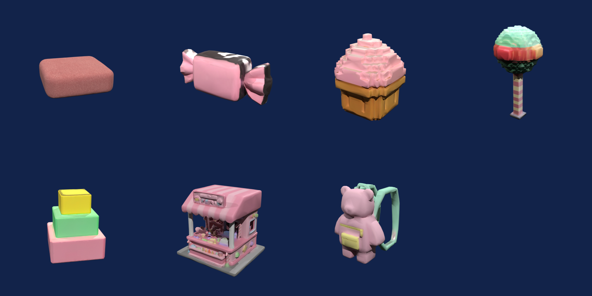
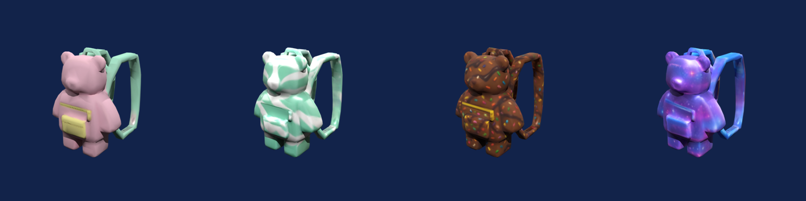
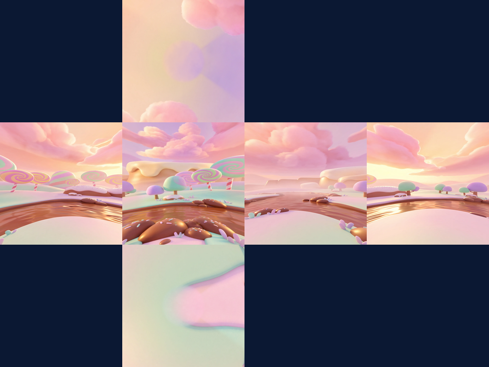

# Candy Climb (candy obby)

A real game, made end to end by the Roblox Studio Team skills with the Sloyd API on 2026-11-04, from the prompt "obby in a candy world". Every image below is a render of an actual exported model from that run. `run-record.json` lists every asset's prompt, triangle count, size in studs, texture size and the credit spend.



## Numbers

| | |
|---|---|
| Props | 7: gumdrop platform, wrapped candy, cupcake checkpoint, lollipop tree, giant cake, candy shop stand, gummy bear backpack |
| Shop skins | 3 retextures of the backpack: Mint Swirl (15 coins), Choco Fudge (30), Galaxy Gummy (60) |
| Sky | 1 skybox, converted to six 1024 px Roblox Sky faces |
| Style | `Roblox` for props and `CozyMobile` for the sky; triangles; 1k textures |
| Triangle budgets | 784 (candy) to 11,999 (cake). Every mesh is under 20,000 |
| Failed jobs | 0 of 11 |
| Roblox-ready | 10 of 10 meshes, each verified by re-importing the exported FBX, OBJ and GLB |
| Credits | **245** (~$3.27), measured on the key: balance 415 → 170 |

| Step | Credits |
|---|---|
| 7 text-to-3D props (25 each) | 175 |
| 3 backpack retextures (15 each) | 45 |
| 1 skybox | 25 |

## What the pipeline caught

- **Textures were oversized for Roblox.** Sloyd returned 1024–2048 px textures even with `textureResolution: "1k"`. The exporter sized each one by stud size: 256 px for the candy and the backpacks, 512 for the platform, cupcake and stand, and 1024 for the tree and cake.
- **No decimation was needed.** Sloyd met every `targetFaceCount` exactly. The decimator stays in place for models that arrive over budget, or for your own FBX files.
- **GiantCake has 21 open edges** after export. That's under the warning threshold, and it imports normally.
- **The `Roblox` style is blocky.** It turned the cupcake and the lollipop tree into stepped, voxel-like shapes, and the cake into plain boxes. The game-designer skill now says to pick `CozyMobile` or `Cartoon` when a design wants smooth, rounded forms.



*Same mesh and fit, four looks: Classic (free), Mint Swirl, Choco Fudge and Galaxy Gummy.*



*The six Sky faces laid out as a cross (preview at 256 px per face). The horizon and the chocolate river line up across Left, Front, Right and Back.*

## Files

```
design-doc.md          pitch, loop, economy, art direction, asset table, cost
plan.json              the plan the run executed (prompts, roles, studs, budgets, skins, sky)
run-record.json        every asset: tool and settings, triangles, studs, texture size, spend
images/                contact sheets, the sky cross and one render per asset (renders/)
export/roblox/IMPORT.md  every file the run exported, with triangles, size, texture and collision
GameConfig.luau        the luau-scripter config filled in with this run's real sizes
```

The 3D models, textures and sky faces aren't included. The renders are, so you can judge the quality. To make this game, or your own version of it, run the plan with your own Sloyd key. It costs 245 credits.

First install the skills and save your key (the main README's [Install](../../README.md#install), Steps 1 to 5). Then, in your project folder, download the plan:

```bash
mkdir -p roblox-assets && curl -fsSL -o roblox-assets/plan.json https://raw.githubusercontent.com/Sloydai/roblox-studio-team/main/examples/candy-climb/plan.json
```

and ask your agent: *"Use roblox-producer to build the plan in roblox-assets/plan.json."*

The same steps by hand:

```bash
python3 .agents/skills/sloyd-api/scripts/sloyd.py estimate roblox-assets/plan.json
python3 .agents/skills/sloyd-api/scripts/sloyd.py run roblox-assets/plan.json --out roblox-assets
python3 .agents/skills/prop-modeler/scripts/roblox_mesh.py batch roblox-assets/manifest.json
python3 .agents/skills/world-backdrop/scripts/roblox_sky.py --job roblox-assets/sky/sky_job.json --out roblox-assets/sky
python3 .agents/skills/luau-scripter/scripts/build_place.py roblox-game
```

Then copy this folder's `GameConfig.luau` over `roblox-game/src/shared/GameConfig.luau` (it has this run's real sizes) and run the last command again.

Then follow [export/roblox/IMPORT.md](export/roblox/IMPORT.md) to bring the models into Roblox Studio.
